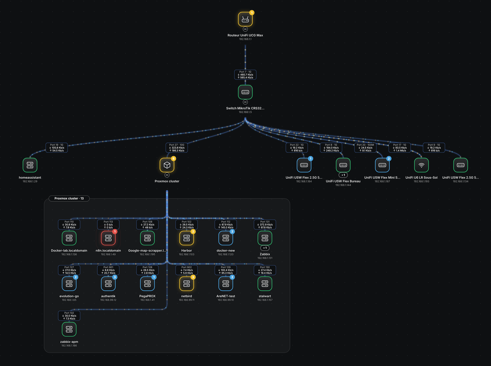
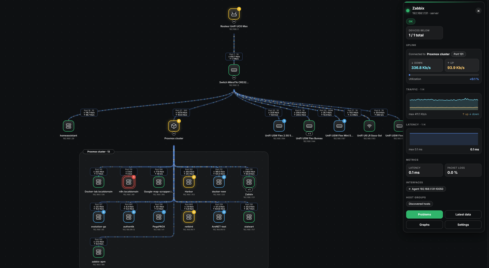
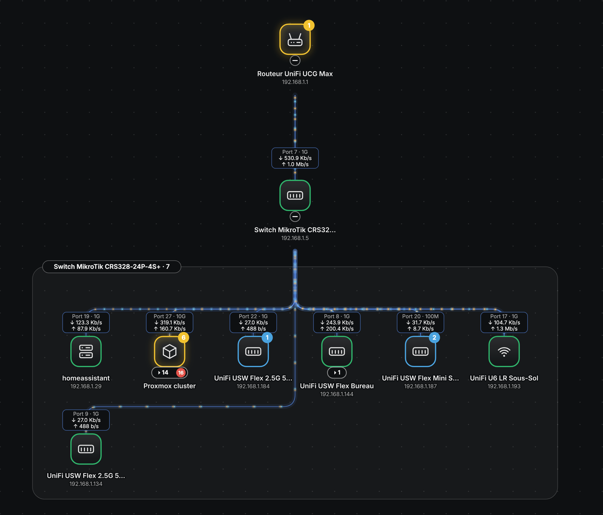
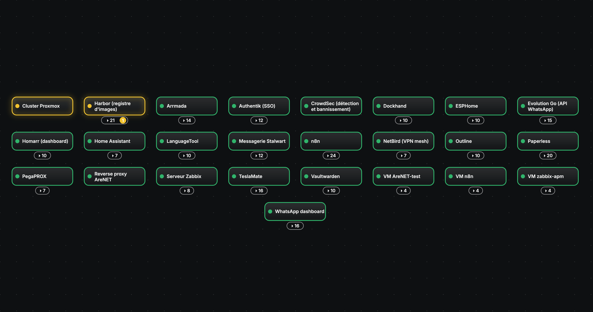
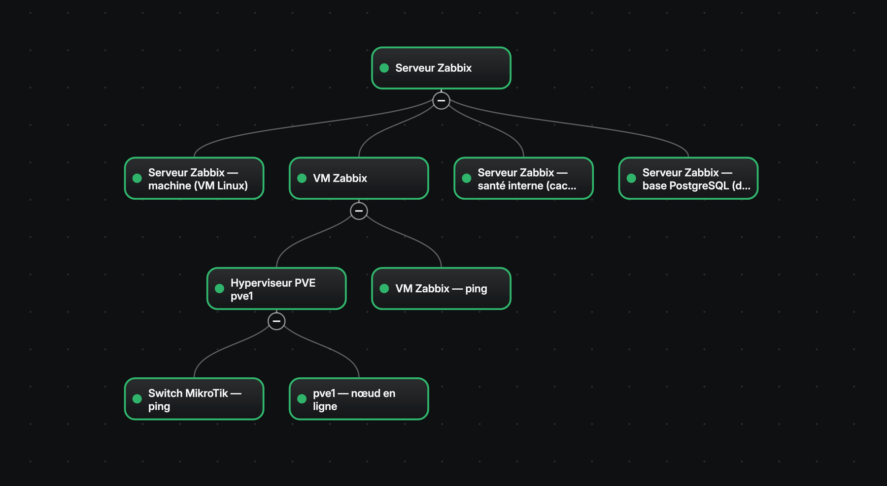

# Cablemap — Zabbix 8.0 topology map module

A frontend module (Monitoring → Cablemap) that draws a clean, automatic **hierarchical map** of your infrastructure
from simple **host tags**, with:

- live **port traffic** on each link (↓ in / ↑ out, link width scales with load),
- **Zabbix problems** as colored rings with counters,
- **topology-aware root cause**: an unreachable host whose parents are fine is flagged *root cause*, everything
  behind it is dimmed as *impacted*,
- zoom / pan, 30 s auto-refresh, click a host to open its problems. No database, no external service.

Tested on Zabbix 8.0 (PHP 8.x). Should work on 7.x frontends using module manifest 2.0.

## Screenshots



| | |
|---|---|
|  |  |
|  |  |

## Install

All paths below are on the **Zabbix web (frontend) server**, not on your workstation.

1. Find the frontend directory (the one that contains `zabbix.php`):
   ```bash
   find / -name zabbix.php -not -path '*/proc/*' 2>/dev/null
   ```
   With the Debian/Ubuntu packages it is `/usr/share/zabbix/ui`; other distributions and Docker images can differ.
   The modules directory is `<frontend>/modules`.
2. Download the zip from the [releases page](https://github.com/barto95100/zbx-cablemap/releases) and unpack it there:
   ```bash
   sudo unzip cablemap-0.7.0.zip -d /usr/share/zabbix/ui/modules/   # creates .../modules/cablemap
   ```
   Or clone the repository and copy the folder to `<frontend>/modules/cablemap`, or use `./deploy.sh` from your
   workstation (see below).
3. *Administration → General → Modules → Scan directory* → enable **Cablemap**.
4. Open *Monitoring → Cablemap*.

## Describe your topology with tags

| Tag (default)      | Value                     | Meaning |
|--------------------|---------------------------|---------|
| `cablemap.uplink`  | `<parent host>:<port>`    | Link to the parent device **and** the parent's port (ifIndex or interface name) used to read traffic |
| `cablemap.parent`  | `<parent host>`           | Link without traffic |
| `cablemap.root`    | anything                  | Marks the top of the tree (otherwise the most connected host is used) |
| `cablemap.speed`   | `1G`, `2.5G`, `100M`, `10000` (Mb/s) | Optional, on the child: port capacity when it can't be read from an item |
| `cablemap.swap`    | `1`                       | Optional, on the child: swap up/down for this link when the parent device reports its counters the other way round (seen on some gateways) |

`<parent host>` is the technical host name or the visible name. Tags `nt:uplink` / `nt:parent`
(ZabFox / Network Topology) are also recognized, so existing tagging keeps working.

Link animation and color reflect the **utilization** (traffic ÷ port capacity), not the raw rate: 11 Kb/s on a
1 Gb/s port barely moves, 200 Mb/s flows noticeably, and the link turns amber (50 %) then red (80 %).
Capacity comes from `cablemap.speed`, else from the parent's `net.if.speed[ifHighSpeed.<port>]` /
`ifSpeed` items, else `utilization.default_speed_bps` (1 Gb/s).

Traffic is read from the parent's items; by default `net.if.in[ifHCInOctets.<port>]` /
`net.if.out[ifHCOutOctets.<port>]` (standard SNMP templates), falling back to `ifInOctets` and the agent's
`net.if.in[<port>]`. Values are expected in bits per second (use `multiplier` for others).

Virtual machines work the same way: tag each VM with `cablemap.uplink = <hypervisor host>:<vm id>` and the
hypervisor's per-VM network items are used (see *Traffic sources* below). A VM without such a tag, or whose id is
not exposed by the hypervisor template, is still drawn under its parent, just without a rate.

## Using the map

- **Zoom** with the **+ / −** buttons (around the center of the view) or the mouse wheel (small steps, anchored on
  the pointer; trackpads stay progressive). **Recenter** fits everything again.
- **Drag a node** to move it (**Shift + drag** moves it with its children); positions are remembered in your browser.
  **Recenter** fits the view, **Reset layout** forgets manual positions and folds.
- Large groups (more than 6 children) are drawn in a labelled frame; children that have their own children are
  folded by default (badge `+N`). Click the badge / the `–` button to unfold / fold, or use *Display → Groups*.
- *Display* menu: link traffic on/off, animation on/off, link style (curved, rounded, angled).
- Node icons depend on the type: router, switch, Wi-Fi, hypervisor, storage, server (rules in `types`, matched on
  host-group names or host names).

## Configuration (optional)

Everything has a default (`config.default.json`). To change something, copy `config.example.json` to
`config.json` next to it and keep only what you override: tag names, traffic item keys, device-type rules
(regex on host-group names → network / hypervisor / server), host-group scope, hiding unlinked hosts,
minimum problem severity, refresh period, colors and **all UI labels** (a French example is included).
`config.json` is never overwritten by `deploy.sh`.

## Deploy script

```bash
echo 'ZBX_HOST=user@zabbix.example.com' > .deploy.env   # needs passwordless sudo on that host
./deploy.sh
```

Optional: `ZBX_UI_DIR` (default `/usr/share/zabbix/ui`), `ZBX_FPM` (default `php8.4-fpm`, empty to skip).

## Limits

- One parent per host is drawn (first found); the layout is a tree.
- Port traffic needs the parent's items to exist (interface discovery) — otherwise the link shows no labels.
- Modules can't create API methods or tables, so settings live in `config.json`, not in the UI.

## License

GNU Affero General Public License v3.0 — see [LICENSE](LICENSE). Zabbix itself is AGPL-3.0.

## Host panel

Click a node (without dragging) to open a side panel: state, root cause / impacted, uplink port with
speed, in/out rates and utilization, graphs, key metrics, interfaces, host groups, active problems and
shortcuts (Problems, Latest data, Dashboard or Graphs, host settings).

### Graphs

Up to three mini-graphs (last `panel.graph_minutes`, default 60):

1. **Uplink traffic** — for hosts with an uplink tag (counters read on the parent).
2. **Custom graphs** — add the tag `cablemap.graph` to a host. The value is an item key, or a fragment of one,
   optionally prefixed with a label: `Traefik ping|web.test.time[web-traefik,GET /ping,resp]`.
   The tag can be repeated.
3. **Fallback** — when fewer than two graphs were found, the first match of `panel.graph_fallback`
   (CPU utilization, ICMP latency by default).

Metric tiles come from `panel.metrics` (`label` + list of key fragments).

## Languages

The interface follows the language of the logged-in Zabbix user. Translations live in `lang/<code>.json`
(`fr` is provided; copy it to add another one). Entries of `labels` in `config.json` always win.

## Export

The **Export PNG** button saves the whole graph (not only the visible area) with the page background.

## Traffic sources (switches, hypervisors, anything)

The rate of a link is read on the **parent** host (the switch, the hypervisor, the router...), from the first item key
found in `traffic.in` / `traffic.out`. `{port}` is replaced by the part after the colon in the child's
`cablemap.uplink` tag (`<parent host>:<port>`), and `*` matches any text inside a key. So the module is not tied to a
vendor: any template that exposes per-port or per-VM counters can be used.

| Parent is | Tag on the child | `{port}` is | Keys used (shipped by default) |
|---|---|---|---|
| Switch / router / AP (SNMP) | `cablemap.uplink = sw1:Gi1/0/3` | interface name or index | `net.if.in/out[ifHCInOctets.{port}]`... |
| Proxmox VE (template "Proxmox VE by HTTP") | `cablemap.uplink = pve:112` | VM id | `proxmox_ve.node.qemu.network.input/output[*,{port}]` |
| Other hypervisor (VMware, Hyper-V, XCP-ng, libvirt...) | `cablemap.uplink = esx1:<vm or nic>` | whatever your item key contains | add your keys in `config.json` (below) |

Optional tag `cablemap.speed = 10G` gives the link capacity (virtual NICs report none; default is 1G).

### Adding another source

Put the keys of your template in `config.json`. Lists **replace** the defaults, so repeat the ones you still need:

```json
{
  "traffic": {
    "in":  [ {"key": "net.if.in[ifHCInOctets.{port}]", "multiplier": 1},
             {"key": "my.hypervisor.vm.net.rx[*,{port},*]", "multiplier": 8} ],
    "out": [ {"key": "net.if.out[ifHCOutOctets.{port}]", "multiplier": 1},
             {"key": "my.hypervisor.vm.net.tx[*,{port},*]", "multiplier": 8} ]
  }
}
```

- Rates are expected in **bit/s**: use `multiplier` (`8` for bytes/s).
- Direction is from the parent's point of view: "in" = received by the parent on that port = sent by the child.
  For a hypervisor item `network.output` (sent by the VM) therefore goes in `traffic.in`.
- To find the right key: open the parent host in Zabbix, Latest data, search "network", and copy the key.
- Brackets in keys are literal; only `*` is a wildcard.

### Direction of the arrows

On every link, **↑ = traffic going toward the parent** (sent by the child, e.g. an upload from a client) and
**↓ = traffic coming from the parent**. The animated streaks follow the same convention (amber goes up, cyan
goes down). The module also accounts for the root you chose with `cablemap.root`: when a link is declared from the other side
(e.g. the router carries the `uplink` tag pointing at the switch but is drawn on top), up and down are swapped
automatically. If one link shows the opposite of reality while the others are right, the parent reports that port's
counters reversed: add `cablemap.swap = 1` on the child of that link.

## Flow animation

Streak speed and length follow the **utilization of the link capacity** on a logarithmic scale
(0.001 % → slowest, 100 % → fastest), per direction. A 100 Kb/s flow on a 1 Gb/s port therefore looks clearly
slower than 3 Mb/s, while both stay distinguishable from a saturated link.

## Services view

*Monitoring → Cablemap services* draws your Zabbix **Services** tree (the one used for SLA) as a graph. It needs no
extra tagging: it reads the services you already have.

- A parent service depends on its children (a failing child degrades the parent), so parents are on top. A service
  with **several parents** is drawn once, with a link to each of them.
- The color of a card is the status Zabbix computes for the service (green = OK, then the severity colors).
  Links to a failing child are highlighted.
- Branches that contain a problem are **unfolded automatically**; healthy branches are folded below
  `services.default_depth` levels (default 1). `▸ N` = N hidden services (colored badge = problems among them).
  Click `▸` to unfold, the `−` button to fold again, or use *Expand all* / *Collapse all*.
- Click a service for its details: parents, children, status calculation, tags, **problems currently impacting it**
  and the **related hosts**. Hosts come from those problems; for a healthy service they are found by comparing the
  service's problem tags with host tags (best effort). The *Show on infrastructure map* button opens the infrastructure
  map on that host (`?focus=<hostid>`: ancestors are unfolded, the view is centered and the panel opens).
- Same controls as the infrastructure map: **+ / −** and wheel zoom, drag background to pan, drag a card to move it
  (remembered in your browser), *Recenter*, *Reset layout*.
- Settings (`config.json`): `services.default_depth` (levels unfolded by default) and `services.max_columns`
  (cards per row before a level wraps).
- Both pages link to each other with the *Services* / *Infrastructure map* buttons in the toolbar.
